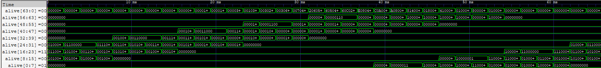

# Miniproject-3

## Overview

This project runs Conway's Game of Life on an 8×8 WS2812B LED matrix, driven by an iCE40 UP5K FPGA on the iceBlinkPico board at 12 MHz. The whole design lives in one SystemVerilog module, `top.sv`, with one output pin (`_31b`) feeding the LED data line.

My variant differs from the original game in two ways:

- **Toroidal board.** The left edge wraps to the right and the top wraps to the bottom, so every cell has exactly 8 neighbors and patterns never fall off the board.
- **Color per generation.** Each new generation is drawn in the next of 8 colors: red, yellow, green, cyan, blue, indigo, violet, white, then back to red.

## Circuit Design

The circuit has three parts: a 64-bit board register with its next-state logic, a color selector, and a WS2812B serial driver.

**Board state and neighbor counting.** The board is a 64-bit register `alive`, where cell (x, y) is bit `y*8 + x`. The function `count_neighbors` splits an index into a 3-bit `x` and `y` and forms x±1 and y±1 in 3-bit arithmetic. That arithmetic overflows naturally (7 + 1 = 0, 0 − 1 = 7), which is what makes the board a torus with no extra logic. Each neighbor's index is just the concatenation `{row, col}`, and the 8 neighbor bits are added into a 4-bit count.

**Next-state logic.** A `for` loop over all 64 cells applies the rule `alive[i] <= (n == 3) || (alive[i] && n == 2)`. Synthesis unrolls it into 64 neighbor counters that work in parallel. Because every cell is written with a nonblocking assignment on the same clock edge, each new cell is computed from the old generation only, as Life requires.

**Color selection.** A 3-bit `color_idx` picks one of 8 24-bit values from a `case` table. Values are in the WS2812B's GRB byte order and use at most `0x1F` per channel to keep brightness and current low. The LED being sent gets that color if its cell is alive, or `0x000000` if it is dead.

**WS2812B driver.** Four counters walk through the frame. At 12 MHz one tick is 83.3 ns.

| Counter    | Range | Meaning                                     |
| ---------- | ----- | ------------------------------------------- |
| `tick_bit` | 0–14  | Ticks within one bit (15 ticks = 1.25 µs)   |
| `bit_idx`  | 0–23  | Which of the 24 color bits, MSB first       |
| `tick_led` | 0–359 | Ticks within one LED (24 × 15)              |
| `led_idx`  | 0–63  | Which LED in the chain                      |

The output is `_31b = sending & (bit ? tick_bit < 9 : tick_bit < 4)`. A 1 bit is high for 9 ticks (0.75 µs) and a 0 bit for 4 ticks (0.33 µs), then low for the rest of the 1.25 µs bit, fitting the WS2812B timing spec.

## Operation

The circuit loops between two phases, switched by the `sending` flag, and shows one new generation about every 177 ms (about 5.7 generations per second).

1. The variable `alive` holds the glider, `color_idx` is 0 and `sending` is 0.
2. `_31b` stays low while `reset_count` counts up to `RESET_TICK_RATE − 1`, which is 2,097,151 ticks. This is far longer than the WS2812B's 50 µs latch time, so it also sets the animation speed.
3. On the last reset tick, all 64 cells move to the next generation in one clock edge, `color_idx` advances, and `sending` goes high.
4. The driver shifts out 64 × 24 bits. After LED 63, `sending` drops and every counter is back at 0, ready for the next frame.

Because the update happens before the first frame is sent, the first frame on the LEDs is generation 1 in yellow (`color_idx` = 1).

## Simulation

The testbench `top_tb.sv` runs `top.sv` in Icarus Verilog with a 12 MHz clock for 0.5 s of simulated time and dumps every signal to `top.vcd`. `RESET_TICK_RATE` is lowered to 200 ticks so many generations fit in the run; this only shortens the idle wait and does not touch the Life logic.

To run it:

```bash
iverilog -g2012 -o top_tb.vvp top_tb.sv
vvp top_tb.vvp
```

The GTKWave trace below shows `alive` split into its 8 rows. The glider's cells move from one row to the next as generations advance, and wrap from the top row back to row 0.



## Conclusion

The circuit correctly implements Conway's B3/S23 rules on a wrap-around 8×8 board, updating all 64 cells in parallel in a single clock cycle. It shows each new generation on the WS2812B matrix about every 177 ms, each in a new color, as the simulation shows.
